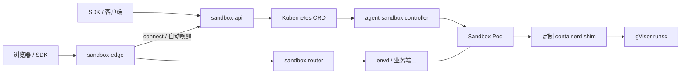

# Sandbox 基础链路

[产品入口](../README.md)。这里说明基础组件；应用、SSO、模型网关和技能广场分别维护。

## 来源与维护位置

| 层 | 来源 / 本地入口 | 维护边界 |
| --- | --- | --- |
| controller、CRD、Router、SDK | 上游 `kubernetes-sigs/agent-sandbox`；fork `Axpz/agent-sandbox`；仓库根目录 | 复用现有源码与构建工具，不在 xsphere 中复制 |
| runsc 与恢复 shim | 外部 `Axpz/gvisor`；[版本与校验值](../runtime/README.md) | 源码、补丁和节点安装工具留在外部仓库 |
| 产品 API | [sandbox-api/](../sandbox-api/) | SDK 契约、Claim 管理、暂停/恢复与 envd 初始化 |
| Edge | [chart/templates/edge.yaml](../deploy/chart/templates/edge.yaml) | Nginx 入口、端口与身份路由、调用 API 唤醒 |
| Router | [根目录 sandbox-router/](../../sandbox-router/) | 查找 Pod 并转发业务流量，不负责恢复内存 |
| 沙箱模板与预热池 | [chart/templates/runtime.yaml](../deploy/chart/templates/runtime.yaml) | Pod、PVC、探针和恢复钩子；节点运行时须预先安装 |

这里的 GitHub 名称是源码来源，不代表已发布制品。controller 镜像、Router 镜像、
API/worker 镜像、业务 runtime 镜像以及 runsc/shim 必须分别记录来源和摘要。
同一镜像标签不证明两种架构或两台节点使用相同内容。

## 生命周期与数据边界

- 默认流程：API 请求 Suspended / Running，controller 删除或重建 Pod，保留业务 PVC。
- 内存流程：先保存并提交 checkpoint，再暂停；恢复时由 shim 读取记录中的 checkpoint。
- Edge 的 connect 可以触发正常唤醒；Router 自身不处理暂停/恢复。
- envd 是沙箱内的命令、文件与初始化接口；它的健康检查不等于任意业务进程健康。
- 内存流程要求单容器运行中、固定节点与兼容的镜像和运行时；不限制重启策略或历史重启次数。
  `Always` 仍可能在 checkpoint 停止容器后、Pod 删除前触发一次重启，不代表新增了异常恢复逻辑。

具体顺序、envd 恢复钩子及失败边界见[生命周期说明](lifecycle.md)。
保存失败可能已停止源进程；保留有效 checkpoint 和 PVC，不能因 Pod Ready 或文件存在
就判定内存恢复成功。正常 paused 与 Running 时节点重启导致的失败 Pod 要分开处理。

## 构建、验证与交付

复用 `make -C xsphere check` 做 API 测试、类型检查、构建和 chart 检查。
controller / Router 仍使用根目录工具链，入口见 [Makefile](../Makefile)。
这些离线检查不会验证真实节点上的内存恢复。

每次交付保留：Git 提交、架构、组件镜像摘要、runsc/shim 校验值、环境配置引用、
验证范围和回退位置。环境配置与凭据继续使用被忽略的 `xsphere/local/`，历史证据放在
`archive/`；冻结基线的校验文件不随日常开发重写。

先渲染、比较，再选择目标环境部署，见[部署说明](deployment.md)。源码提交不代表
任何环境自动升级，也不代表旧 checkpoint 可以跨架构或跨运行时版本恢复。
